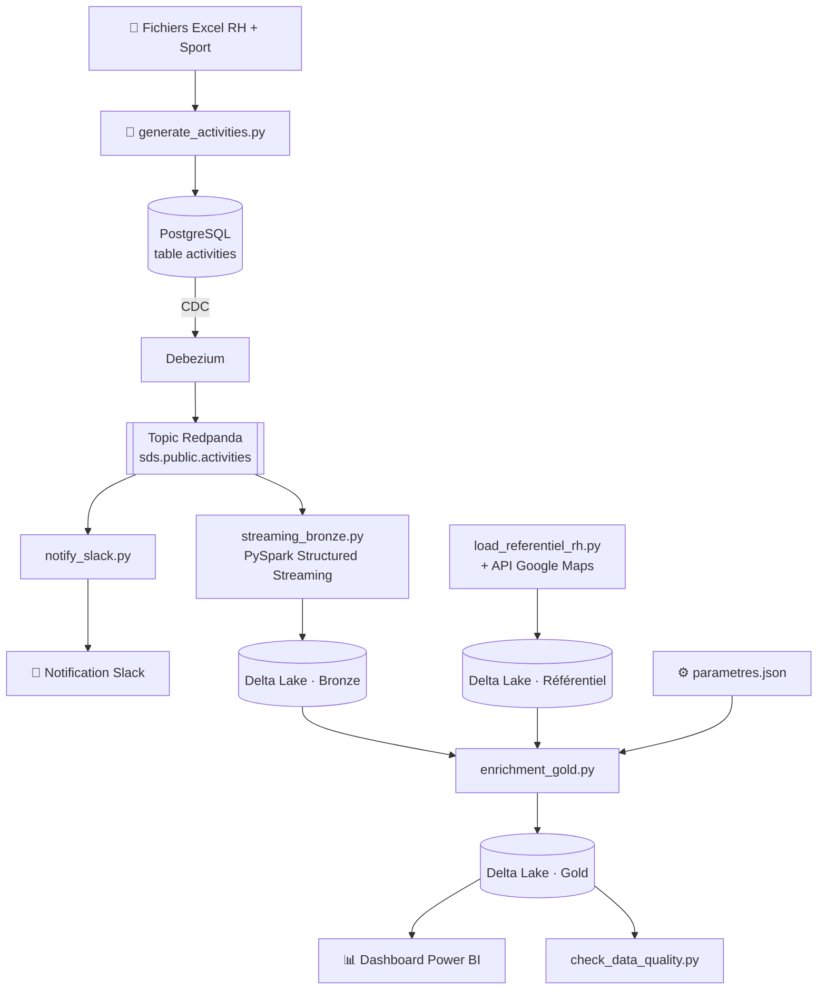

# Sport Data Solution - Pipeline de données en temps réel & Lakehouse

### Une architecture complète de streaming et de Lakehouse, de bout en bout


---

## De quoi parle ce projet ?

**Sport Data Solution** est une startup (fictive) qui veut récompenser ses
salariés quand ils bougent. Ce dépôt contient le pipeline de données complet
que j'ai construit pour leur POC : il récupère les données d'activités
sportives brutes, vérifie qu'on peut leur faire confiance, détermine qui a
droit à deux avantages, et affiche le résultat sur un tableau de bord à jour.
Tout est automatique, du début à la fin.

Les deux avantages :
- 🚲 **La prime de mobilité** : +5 % du salaire annuel brut pour les salariés
  dont le trajet domicile-travail est validé comme vraiment actif (marche,
  course, vélo...).
- 🧘 **Les jours bien-être** : des jours de congés payés pour les salariés qui
  font au moins un certain nombre d'activités sportives dans l'année.

Le but d'un POC comme celui-ci, c'est de prouver que le pipeline
**fonctionne, qu'on peut s'y fier, et qu'il sait s'adapter** si les règles
changent. Pas juste de sortir un rapport figé.

---

## Architecture



En clair : un générateur simule l'activité des salariés et l'écrit dans
Postgres. Debezium surveille cette table et envoie chaque changement dans
Redpanda, une sorte de boîte aux lettres géante compatible Kafka. À partir
de là, deux choses se passent en parallèle : Spark enregistre une copie
brute et fiable de chaque activité (la couche **bronze**), et un script
envoie un message de félicitations sur Slack en temps réel.

De son côté, un autre script enrichit le fichier RH avec les vraies
distances domicile-travail (via Google Maps) pour repérer les fausses
déclarations. Enfin, un dernier job Spark croise les données bronze avec ce
fichier RH enrichi pour calculer qui a droit à quoi, écrit la couche
**gold**, et Power BI vient lire directement dedans.

---

## Les technos utilisées

| Couche | Outil | Son rôle |
|---|---|---|
| Base de données | PostgreSQL | Source de vérité pour les activités générées |
| CDC | Debezium | Envoie chaque changement de Postgres en temps réel |
| Messagerie | Redpanda | Bus d'événements compatible Kafka |
| Traitement | Apache Spark (PySpark) | Ingestion en streaming + enrichissement en batch |
| Stockage | Delta Lake | Architecture médaillon Bronze / Gold |
| Scripts | Python (pandas, psycopg2, kafka-python, Faker) | Génération des données, enrichissement, contrôles qualité |
| Géolocalisation | API Google Maps | Vérifie les distances domicile-travail déclarées |
| Notifications | Slack SDK (webhook) | Messages d'activité en temps réel |
| Dashboard | Power BI | Reporting final, connecté directement à Delta Lake |
| Infra | Docker Compose | Tout l'environnement local en une seule commande |

---

## Structure du projet

```
sport-data-solution/
├── docker-compose.yml          # Lance Postgres, Redpanda, Debezium Connect, Spark
├── sql/
│   └── init_postgres.sql       # Crée la table des activités
├── connectors/
│   └── debezium-postgres-connector.json
├── generator/
│   └── generate_activities.py  # Simule 12 mois d'historique d'activités
├── referentiel/
│   └── load_referentiel_rh.py  # Enrichit les données RH avec la distance de trajet validée
├── spark_jobs/
│   ├── streaming_bronze.py     # Kafka → Delta Lake (bronze)
│   ├── enrichment_gold.py      # Bronze + RH → Delta Lake (gold)
│   └── config/
│       └── parametres.json     # Règles métier (modifiables sans toucher au code)
├── slack_notifier/
│   └── notify_slack.py         # Envoie un message Slack à chaque nouvelle activité
├── tests_qualite/
│   └── check_data_quality.py   # 11 contrôles de cohérence automatiques
└── data/                       # Stockage Delta Lake en local (bronze/gold)
```

---

## Pour démarrer

**Ce qu'il te faut avant de commencer**
- [Docker Desktop](https://www.docker.com/products/docker-desktop/) (avec Docker Compose)
- Python 3.10 ou plus
- Power BI Desktop (pour le dashboard)
- Un espace Slack avec un webhook entrant (facultatif : si tu n'en mets pas,
  les messages s'affichent simplement dans la console)
- Une clé API Google Maps (facultatif : sans clé, les distances restent
  marquées "en attente")

**Installation**

```bash
# 1. Récupérer le projet
git clone https://github.com/yad95/OC-Projet-12-Realtime-Streaming-Pipeline-Architecture.git
cd OC-Projet-12-Realtime-Streaming-Pipeline-Architecture

# 2. Créer et activer un environnement virtuel
python -m venv venv

# Sur Windows :
venv\Scripts\activate
# Sur macOS/Linux :
source venv/bin/activate

# 3. Installer les dépendances Python
pip install -r requirements.txt

# 4. Configurer les variables d'environnement (clés API)
cp .env.example .env
# Ouvre le nouveau fichier .env et colle ton URL de webhook Slack
# et ta clé API Google Maps.
# À noter : le pipeline tourne quand même si ces clés restent vides.
```

---

## Mode d'emploi : lancer tout le pipeline

```bash
# 1. Démarrer l'infrastructure (Postgres, Redpanda, Debezium, Spark)
docker compose up -d

# 2. Générer les activités simulées (12 mois d'historique)
python generator/generate_activities.py --rh-file "Données RH.xlsx" --sport-file "Données Sportive.xlsx"

# 3. Construire le référentiel RH enrichi (validation des distances de trajet)
python referentiel/load_referentiel_rh.py --rh-file "Données RH.xlsx"

# 4. Lancer l'ingestion bronze en temps réel (laisse ce terminal ouvert)
docker exec -it sds_spark /opt/spark/bin/spark-submit \
  --packages io.delta:delta-spark_2.12:3.2.0,org.apache.spark:spark-sql-kafka-0-10_2.12:3.5.1 \
  /opt/spark_jobs/streaming_bronze.py

# 5. (facultatif, dans un autre terminal) Lancer les notifications Slack
python slack_notifier/notify_slack.py

# 6. Calculer la couche gold (éligibilité + coûts)
docker exec -it sds_spark /opt/spark/bin/spark-submit \
  --packages io.delta:delta-spark_2.12:3.2.0 \
  /opt/spark_jobs/enrichment_gold.py

# 7. Lancer les contrôles de qualité des données
python tests_qualite/check_data_quality.py
```

Ensuite, ouvre le fichier Power BI et clique sur **Actualiser**. Il se
connecte directement au dossier gold de Delta Lake, pas besoin d'export.

---

## Changer les règles métier (sans coder)

Toute la logique métier se trouve dans `spark_jobs/config/parametres.json` :

```json
{
  "taux_prime": 0.05,
  "seuil_activites_bien_etre": 15,
  "jours_bien_etre_accordes": 5
}
```

Tu changes une valeur, tu relances `enrichment_gold.py`, tu cliques sur
Actualiser dans Power BI, et tout le dashboard se recalcule. Pas de script à
réécrire, pas de modification à faire ailleurs.

**Petit bonus : la simulation interactive directement dans Power BI.** En
plus de ça, le dashboard contient une page "Simulateur" avec des curseurs
(les paramètres What-If de Power BI) pour le seuil d'activités, le nombre de
jours bien-être accordés et le taux de prime. Quand on bouge un curseur, les
KPI se mettent à jour tout de suite : aucun fichier à modifier, aucun job à
relancer. En coulisses, Spark calcule à l'avance le résultat pour chaque
seuil possible (de 0 à 30) dans une petite table agrégée. Le curseur ne lit
donc que des totaux déjà calculés, et **aucune donnée individuelle (salaire,
nom) n'arrive jamais dans Power BI**, c'est voulu.

---

## Données personnelles et sécurité

Comme ce pipeline manipule des données RH sensibles (salaire, adresse), il y
avait quelques règles non négociables :

- Le salaire et l'adresse ne sortent jamais de la couche de traitement
  sécurisée : ni dans les messages Slack, ni dans le dashboard Power BI.
- La couche gold est séparée en deux : une table détaillée à usage interne,
  et une table agrégée et non nominative pour Power BI.
- Les clés API et les URL de webhook sont dans des variables
  d'environnement, jamais écrites dans le code.
- Chaque "trajet actif" déclaré est automatiquement comparé à une vraie
  distance (API Google Maps) pour repérer les déclarations incohérentes.

---

## Qualité des données

Avant qu'un chiffre n'arrive dans le dashboard, `check_data_quality.py`
lance 11 contrôles automatiques : pas de distance négative, pas de date dans
le futur, cohérence entre les activités et les salariés, montants calculés
cohérents, et d'autres encore. État actuel : **11/11 validés**.

---

## Exemples de résultats

Sur le jeu de données simulé (161 salariés, environ 6 600 activités
générées) :

- 💶 environ 172,5 K€ de budget total estimé pour la prime de mobilité
- 🧘 540 jours bien-être accordés
- ✅ 0 anomalie de distance détectée

---

## Pistes pour la suite

- Se brancher sur la vraie API Strava à la place du simulateur
- Passer l'infrastructure Docker locale sur un environnement cloud managé
- Ajouter des alertes proactives quand une anomalie est détectée
- Seuils dynamiques via Power BI : permettre aux équipes métier de modifier
  les seuils d'activités et les taux de prime directement depuis le
  dashboard, sans toucher aux fichiers de configuration.

---

## 👤 Auteur

**YILMAZ - AD**, Data Engineer
Réalisé dans le cadre de la formation Data Engineer d'OpenClassrooms
(Projet 12 : Gérer un projet d'infrastructure).
